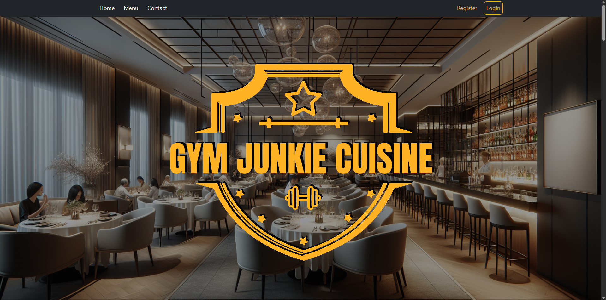
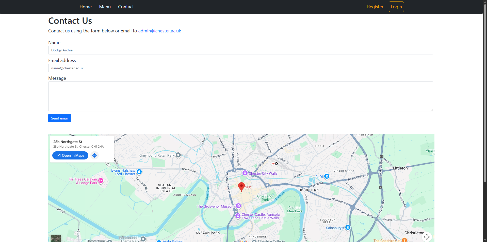
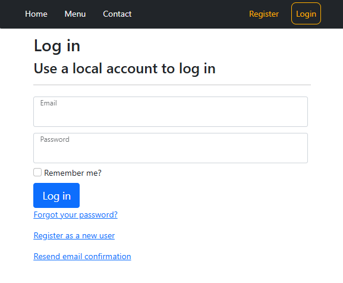

# Gym Junkie Cuisine

ASP.NET Core Razor Pages site for a fitness-focused restaurant in Chester. Customers browse the menu, create an account, and check out with Stripe. Admins manage dishes.

Built with .NET 6, ASP.NET Identity, Entity Framework Core (SQL Server), and Bootstrap.

 

